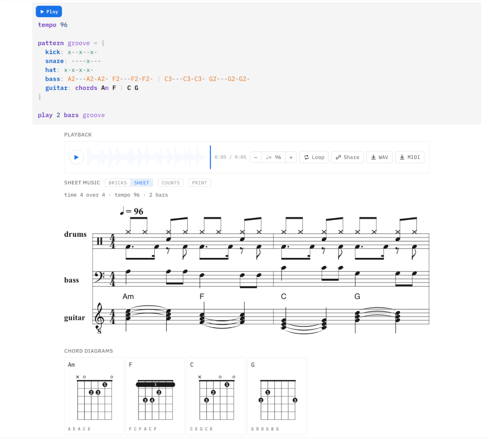

# composer-nb

**Sketch music like you write code.** Drums, riffs and chords in a small language you can read at a glance. Play a cell and hear it, with a grid of what plays or the whole thing as sheet music, and chord shapes for guitar. It runs in your browser, and in Claude.

**[Open the playground →](https://composer-nb.vercel.app)** · **[Docs](https://pkhambat.mintlify.site)**

<p align="center">
  
</p>

## Write and play music

A cell contains settings, typed declarations and statements. `play({ ... })` constructs a block by default: its lines play once, with any unfinished bar space filled by silence. Use `pattern({ ... })`, or a named pattern, to repeat completed bars.

```composer-nb
set tempo 96
pattern groove = {
  kick: 4*x---,
  snare: 2*(4*- x 3*-),
  hat: 8*x-,
}
play({ crash: x, groove }) for 4 bars
```

`kick: x---` is one hit followed by silence for the rest of its bar. `4*x---` writes four hits in that bar. `|` finishes the current drum bar with silence, and a final unfinished bar is padded even without `|`. A container can end partway through a repeating part.

## Notes, chords and voicing

Notes and chords divide each written bar into equal slots. For fixed-step riffs, use `every`: this plays four sixteenth notes and pads the rest of the bar with silence.

```composer-nb
play(every 1/4 beats piano: note(1 2 3 5))
```

`note(...)` and `chord(...)` supply a type inside expressions. Names and interval functions keep that type. For whole sequences, the `notes` and `chords` prefixes are also accepted.

`voice` moves selected chord tones by octaves without changing the harmony. Its second argument is an object: `1` is up an octave, `-1` is down. A slash bass stays unchanged.

```composer-nb
chords inclinationHome = voice(2m9, { fifth: 1 })
print(inclinationHome)
play({ piano: inclinationHome })
```

In C major, octave 3, this prints **2m9** → Dm9 → (D3 F3 C4 E4 A4). Only the leading value is bold. Spaces separate values within one print argument; commas separate arguments. See [voice](https://pkhambat.mintlify.site/functions/voice) and [print](https://pkhambat.mintlify.site/functions/print).

## Place an event in a later bar

Write the placement after the part. A bare body is a block, so the extra crash below sounds once on bar 2.

```composer-nb
pattern groove = {
  kick: 4*x---,
  hat: 8*x-,
  { crash: x } on bar 2,
}
play(groove) for 4 bars
```

## From an assistant

composer-nb is an [MCP](https://modelcontextprotocol.io) server too, so Claude, Cursor or any assistant that speaks MCP can write a cell, check it against the parser and draw the sheet; in claude.ai and Claude Desktop the cell plays right in the chat. In Claude, install the plugin, which brings the connector with skills: add `pkhambat1/composer-nb` as a marketplace (Customize → Plugins → Add → Add marketplace; in Claude Code, `/plugin marketplace add pkhambat1/composer-nb`), then install `composer-nb` (`/plugin install composer-nb@composer-nb`). Or add a custom connector with the URL `https://composer-nb.vercel.app/mcp`; elsewhere, give that URL to the assistant as a remote MCP server. See [Assistants](https://pkhambat.mintlify.site/assistants) in the docs.

The editable notebook MCP App in this checkout shares the website's cells, bricks,
sheet music, chords and playback. It uses the host's own chat composer and an explicit
saved notebook file. See [MCP development setup](mcp/README.md); this development
integration has not yet been deployed through the published connector above.

## What's here

| Folder        | What it is                                                                                                                                                                                             |
| ------------- | ------------------------------------------------------------------------------------------------------------------------------------------------------------------------------------------------------ |
| `dsl/`        | The language: the parser, chord builder and audio renderer in `dsl/src/`, which the playground and the MCP server both run. Not published.                                                              |
| `playground/` | A notebook-style web app for writing the language and hearing it. It uses `dsl/` as a package, so both always run the same parser.                                                                     |
| `mcp/`        | The [MCP server](mcp/README.md): the language for assistants, and the notebook app they open. `api/` serves it on Vercel at `/mcp`, with the sheet and MIDI of a cell at `/api/sheet` and `/api/midi`. |
| `plugin/`     | The [Claude plugin](plugin/README.md): that server as its connector, and skills. `.claude-plugin/marketplace.json` lists it, so this repository is its marketplace.                                    |
| `docs/`       | The [docs site](https://pkhambat.mintlify.site): `.mdx` pages and `docs.json`, built by [Mintlify](https://mintlify.com). Also the images in these READMEs.                                            |

## Working on it

```bash
npm install     # installs workspace dependencies
npm run dev     # playground at http://localhost:5173
npm test        # language, notebook and MCP tests
npm run lint
npm run typecheck   # tsc over the library, the playground, the MCP server and the Vercel functions
npm run build   # builds the library, the MCP server and the playground
npm run mcp     # the MCP server at localhost:3333/mcp, for trying the MCP app before it's deployed
npm run docs    # docs site preview at http://localhost:3000
```

The library (`dsl/src/`), the playground (`playground/src/`), the MCP server (`mcp/src/`) and the Vercel functions (`api/`) are TypeScript; `vocab.ts` holds every word the language knows. Inside this repository everything runs the source: the playground and the tests resolve `composer-nb/*` to `dsl/src/` and `composer-nb-mcp/*` to `mcp/src/` through the `composer-nb-source` export condition, Node (22.18 or later) runs it with `--conditions=composer-nb-source`, and `npm run typecheck` checks it the same way. What's deployed runs the build instead, which `tsc` compiles: the Vercel functions run `dsl/lib/` and `mcp/lib/` (`npm run build:lib -w dsl`, then `-w mcp`). `dsl/tests/corpus/` holds what every real cell (docs examples, grooves, skill examples) plays: a change to the engine that changes it fails `npm test`, and `npx vitest run -u` in `dsl/` rewrites it for a change that's meant.

## Releasing the docs

The docs site is built by [Mintlify](https://mintlify.com) from the [`docs/`](docs) folder. Pages are `.mdx` files and the navigation is in [`docs/docs.json`](docs/docs.json). Every merge to `main` deploys it.

Mintlify publishes every `.md` and `.mdx` file in `docs/`, whether or not it is in the navigation. Folders that aren't pages are listed in [`docs/.mintignore`](docs/.mintignore).

The `composer-nb` examples in the pages are parsed by `npm test` ([`dsl/tests/docs.test.ts`](dsl/tests/docs.test.ts)), so a page that falls behind the language fails CI.

## Releasing the playground

The playground is a static site on [Vercel](https://vercel.com), built from this repository. Its build settings are in [`vercel.json`](vercel.json): it builds the `playground` workspace and serves `playground/dist`.

The Vercel project is `composer-nb`, served at [composer-nb.vercel.app](https://composer-nb.vercel.app). There is nothing to do for each release: every merge to `main` deploys the playground, and every pull request gets a preview link.
