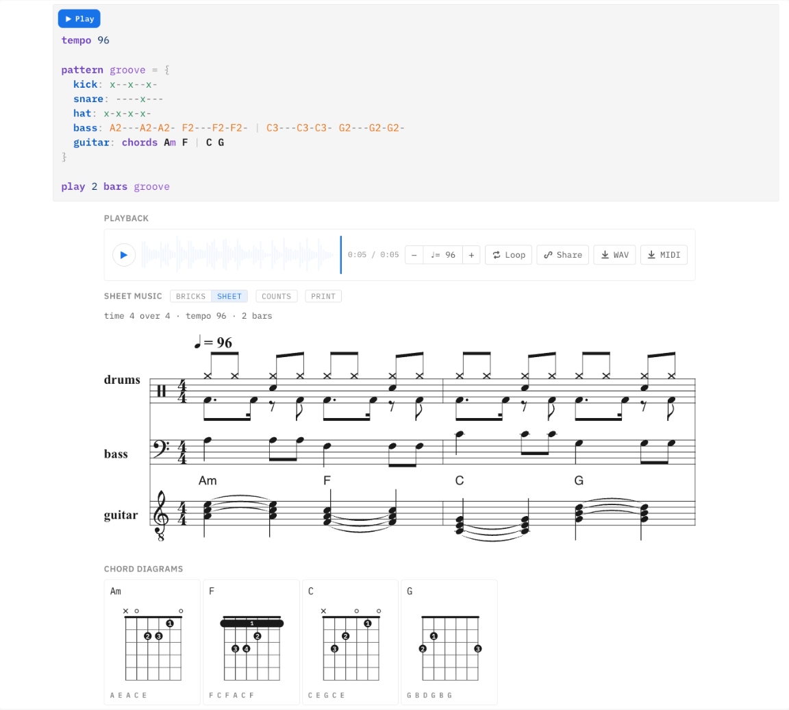
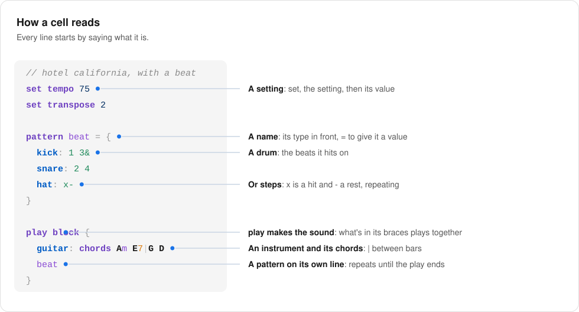
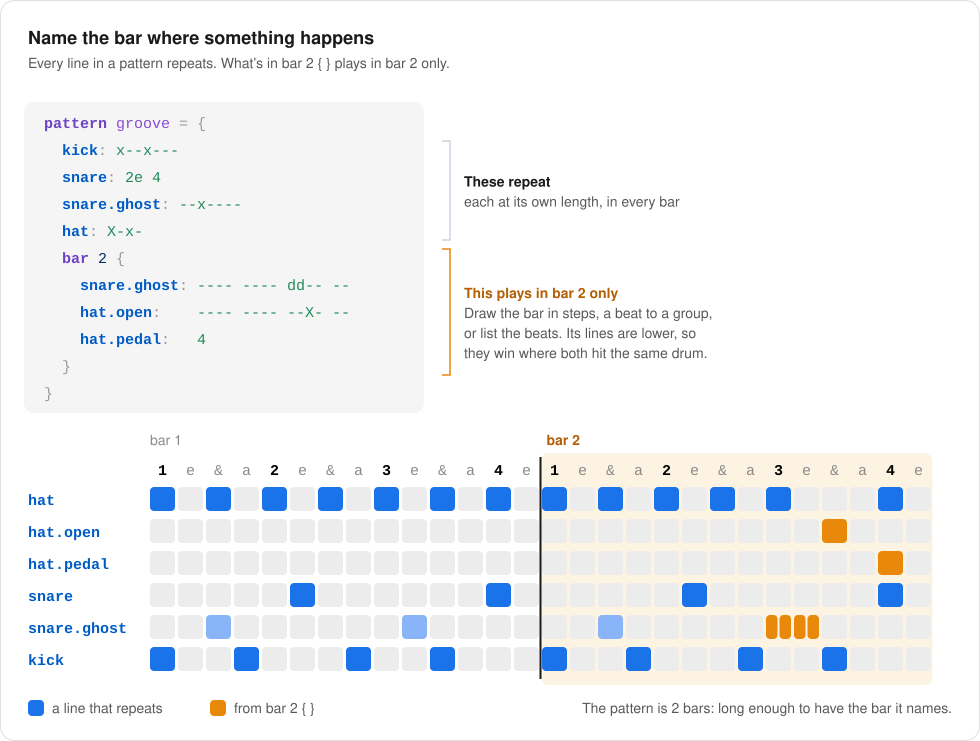
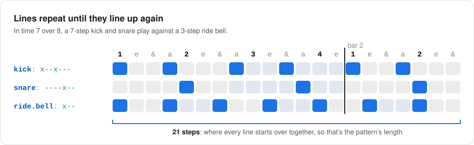

# composer-nb

A small language for drums, notes and chords, played right inside Jupyter notebooks. Run a cell and hear it, with a grid of what plays, chord shapes for guitar, and a WAV to keep. **[Try it in your browser](https://composer-nb.vercel.app)**, with nothing to install. The full reference is in the **[docs](https://pkhambat.mintlify.site)**.

<p align="center">
  
</p>

```
%%music
// what happens now: crash once, the groove repeating under it
set time 7 over 8

pattern groove = 3 bars {
  kick: x--x---,
  snare: ----x--,
  ride.bell: x--,
}

play block {
  crash: x,
  groove,
} for 6 bars
```

Each `play` renders to audio in the notebook, with a play button, a waveform, a grid of the drums and notes, the chords it heard and any mistakes it found.

## Install

```bash
pip install composer-nb
```

Then, in a notebook:

```python
%load_ext composer_nb
```

It works in JupyterLab, Jupyter Notebook 7, VS Code and Google Colab. Sounds are rendered in your browser, and the piano, guitar and drum samples load from the web, so you need an internet connection. Press Tab inside a `%%music` cell for completions.

## Cells that continue from each other

Give a cell a name, and later cells can start from the settings and names it ended with:

```
%%music intro
set tempo 75
set transpose 2
chords riff = Am E7|G D
play guitar: chords riff
```

```
%%music verse after intro
play guitar: chords F C|Dm E7 riff
```

`verse` plays two semitones up, as a capo at fret 2 would, at 75 bpm, and can use `riff`, wherever it sits in the notebook and whenever you run it. If `intro` hasn't been run yet, you get an error saying so. A cell can still change anything it inherits: `set tempo 90` in `verse` speeds up just `verse`.

A cell with no name plays on its own and isn't saved.

## From Python

`%%music` is a shortcut for `Song`, which you can use directly:

```python
from composer_nb import Song

intro = Song("set tempo 75\nplay guitar: chords Am E7|G D", name="intro")
verse = Song("play guitar: chords F C|Dm E7", after=intro, name="verse")
verse  # shows the player
```

Songs are ordinary Python values, so you can generate them with loops and functions:

```python
groove = "pattern groove = {\n  hat: x-,\n  kick: x 7*-,\n  snare: 4*- x 3*-,\n}\n"
rungs = "\n".join(f"with tempo {t} {{ play groove for 2 bars }}" for t in (70, 80, 90))
Song(groove + rungs, name="ladder")
```

## From JavaScript

The same player is on npm as one ES module. `music` takes the source and gives back the player as a DOM node, so it shows up in an [Observable](https://observablehq.com) notebook cell, or anywhere else you put it on a page.

In an Observable notebook:

```js
import { music } from "npm:composer-nb"

const intro = display(
  music(`set tempo 75
set transpose 2
chords riff = Am E7|G D
play guitar: chords riff`),
)
```

```js
music(`play guitar: chords F C|Dm E7 riff`, { after: intro, name: "verse" })
```

`after` and `name` work as they do in Python, and `after` takes what an earlier `music` call returned. The source is a string, so other cells can write it. With a tempo slider called `bpm`, this cell plays at the new tempo each time the slider moves:

```js
music(`set tempo ${bpm}
play piano.electric: chords Am F|C G`)
```

Anywhere else, `npm install composer-nb`, or import `https://cdn.jsdelivr.net/npm/composer-nb/+esm`.

## The language

Every line starts by saying what it is:

<p align="center">
  
</p>

| Line                   | What it is                                                                         |
| ---------------------- | ---------------------------------------------------------------------------------- |
| `set tempo 90`         | A setting: `set`, then the setting and its value. At the top only                  |
| `with key E { ... }`   | Settings for its block only: at the top, around statements; inside braces, a block |
| `steps pair = ^-x-`    | A name, with its type in front: `steps`, `notes`, `chords`, `pattern` or `block`   |
| `kick: x--x---`        | Inside braces, an instrument and what it plays                                     |
| `lift on bar 2`        | Inside braces, what plays in one bar of the pattern or play it's in                |
| `play block { ... }`   | Plays what's after it, a pattern or one line. Nothing else makes sound             |
| `play pattern { ... }` | A play whose lines repeat, as a pattern's do                                       |

`//` starts a comment. Inside braces, entries require commas, with an optional trailing comma before `}`. Semicolons are errors. Newlines inside braces are layout; outside braces, statements use separate lines. Blank lines and indentation mean nothing. Settings set at the top, and names, carry on into the cells below.

### Types

A name's type goes in front of it, and `=` gives it its value:

| Type      | What it holds                                                                 | Where it goes                                                 |
| --------- | ----------------------------------------------------------------------------- | ------------------------------------------------------------- |
| `steps`   | A drum's hits: `steps pair = ^-x-`                                            | On a drum's line: `hat: pair`                                 |
| `notes`   | A line of notes or degrees: `notes riff = E---F# E-E--`                       | After `notes` on an instrument's line: `guitar: notes riff`   |
| `chords`  | Bars of chords: `chords verse = Am F\|C G`                                    | After `chords` on an instrument's line: `piano: chords verse` |
| `pattern` | Lines in braces that play together, over and over: `pattern groove = { ... }` | On a line of its own, or after `play`                         |
| `block`   | Lines in braces that play together, once: `block accent = { ... }`            | On a line of its own, or after `play`                         |

Braces without a name say their type too: `pattern { ... }` repeats and `block { ... }` plays once. A bare `{ ... }` after `play`, on a line of its own or in brackets is an error.

A name of any type starts with a lowercase letter and takes a capital for each new word: `riff`, `partA`, `countIn`. It's at least two characters and never a numeral, and two names that differ only in their capitals are an error. A name only holds its type, and only goes where that type goes. Chords on a drum's line, or steps where a pattern belongs, is an error that names both types. A name without a type is an error too, and the message shows the line to write.

### Settings

A setting is `set`, then the setting and its value: `set key A`. It applies from its line to the end of the cell, and on into later cells. `set` goes at the top of a cell only.

| Setting     | Default    | Meaning                                                                                                                                                      |
| ----------- | ---------- | ------------------------------------------------------------------------------------------------------------------------------------------------------------ |
| `time`      | `4 over 4` | Notes in a bar, over which note: `7 over 8`, or felt in groups: `3+4 over 4`                                                                                 |
| `tempo`     | `120`      | Quarter notes per minute                                                                                                                                     |
| `swing`     | `off`      | Swung eighths, a triplet feel: `on` or `off`                                                                                                                 |
| `key`       | `C`        | The root degrees and Roman numerals count from: a note, `E`, `F#`, `Bb`                                                                                      |
| `mode`      | `major`    | How the key is written on the sheet: `major`, `minor`, `dorian`, `phrygian`, `lydian`, `mixolydian`, `locrian`, `harmonicMinor`, `melodicMinor`, `wholeTone` |
| `transpose` | `0`        | Semitones every pitched instrument sounds from what's written, -12 to 12                                                                                     |
| `octave`    | `3`        | Octave for chords, degrees and notes written without one, 1 to 6                                                                                             |
| `kit`       | `rock`     | Drum sound: `rock` or `synth`                                                                                                                                |

Settings and lengths can use arithmetic (`set tempo 60*2`, `(1+2) bars groove`). `*` repeats step words with an integer count of at least two. That's why a time is `7 over 8` rather than `7/8`.

`with` gives settings to a block only, with commas between them, and puts back what was set at its `}`: `with key E, mode minor { ... }`. At the top of a cell its block holds statements, such as `play`. In a play or a pattern its block plays together with the other lines, and in brackets it's one part in order, so the bass can sit an octave below the chart, or one chart can play in two keys:

```
chords walk = i ii|iii iv|v vi|vii i
chords prog = i vi|iv v

with key E, mode minor {
  play block {
    piano: chords walk,
    with octave 2 { bass: notes i---v--- },
  },
}

play (
  with key E { piano: chords prog, }
  with key G { piano: chords prog, }
)
```

Names declared in a `with` stay in it, and nothing in it carries into later cells. Time, tempo and swing go on a `with` around a whole play, or on a part that plays in order, since lines that sound together share one tempo.

### Notes and chords

`piano`, `piano.electric`, `organ`, `bass`, `guitar` and `guitar.electric` play notes and chords, each on a line of its own like a drum. The instrument is the line's name, so there is no setting for it.

Notes are drawn on the steps, a note where a drum has its `x`:

```
set time 7 over 8
set octave 2

pattern groove = {
  kick: x--x---,
  snare: ----x--,
  guitar.electric: notes E---F# E-E--,
}

play groove
```

A note is a capital letter, `A` to `G`, with `#` or `b` after it and an octave when it needs one: `F`, `F#`, `Bb`, `E2`. Without a number it's in the `octave` setting, so `set octave 2` above puts the riff on the guitar's low E string. One note is one step, however many characters it takes, and two notes never touch: a space goes between them (`F# E`). `-` means nothing new happens, so the note rings on, and `_` stops it. `^` in front accents a note and `~` softens it.

A degree goes where a note goes: a signed nonzero integer, counted through the scale of the `key` and its `mode`. `b` or `#` in front moves it off the scale. `1` is the root in the `octave` setting. Degrees continue through higher octaves: `8` and `15` are the next two tonics in seven-note modes; `7` and `13` are the next two in six-note whole tone. All digits belong to the degree: `13` is one note and `1 3` is two. Negative degrees count down from the tonic, skipping zero: in C major `-1` is the B below C, `-2` is A, `-7` is the lower C and `-14` is two octaves down. In whole tone `-6` is the lower tonic. Put the sign before an accidental (`-b1`) and spaces before negative notes (`-1--- -2---`); dashes within `1---2---` still sustain. `octave(phrase, -1)` lowers a whole phrase; apostrophes are no longer accepted. Lowercase Roman numerals remain accepted.

```
set time 4 over 4
set key A
set mode minor
notes scale = 1---2---3---4---|5---6---7---8---
notes answer = fifth(scale)
play piano: notes answer
```

`second`, `third`, `fourth`, `fifth`, `sixth`, `seventh`, `octave`, and `ninth` through `fifteenth` move every note through the active scale or mode. `unison` leaves it in place. They take a note, chord, inline phrase or named phrase, preserving rhythm. `fifth(B3)` is F4 in C major. `fifth(phrase, 2)` repeats the move twice, and `fifth(phrase, -1)` moves down a fifth; zero is the identity. The count is an integer from -64 to 64. Named results resolve in the key and mode where they play. `of` remains available for counting on another root's major scale.

Notes use step repeats: `bass: notes C2 11*- G1 11*-` holds each note for three beats on the default grid. `8*C2` starts eight notes, while `C2 7*-` holds one for eight steps. `8*_` is eight silent steps; `2*(C2--- G1---)` repeats a group. A final `...G1` holds G1 to the end of the block, `...-` sustains the preceding note, and `..._` fills with silence. A line plays one note at a time. For more, its line takes a block of layers, which play together:

```
play piano: {
  notes C5-D5-E5-G5-E5-D5-C5---,
  notes C3 15*-,
}
```

Chords are written by the bar, with `chords` in front:

```
play guitar: chords C - - G|Am - F G|%|F - _ -
```

`|` separates bars, whose chords split the time evenly. `-` holds, `_` is silence and `%` repeats the preceding bar. Write symbols (`Cmaj7`, `F#m`, `C6/9`, `C/E`) or numeric degrees (`1 6 4 5dom7`). All digits form the root degree: `17` is degree seventeen. Start extensions with a quality: `1maj7`, `2m7`, `5dom7`. Plain degrees take the mode's triads, and suffixes override or modify them: `5m`, `2add11`.

Suffixes compose: `1sus2add11#5/4` replaces the third with a second, adds an eleventh, raises the fifth, and puts degree 4 of the key in the bass. In C it plays C D G# F over F. A slash bass can be a letter or a degree; `1M6/9/3` is degree 1 with a 6/9 quality over degree 3. `fifth(chords)` moves every chord tone and its bass through the scale, so qualities may change: `fifth(3)` is Bdim in C major.

### Drums

`kick`, `snare`, `hat`, `ride` and `crash` are drums, one to a line, and so are the three toms: `tom.high`, `tom.low` and `tom.floor`. Some drums have other sounds with lines of their own: `ride.bell`, `hat.open`, `hat.pedal`, `snare.rim` (a rimshot), `snare.cross` (a cross-stick) and `snare.ghost` (the snare's ghost notes, so they can sit under its main line). A drum plays step words:

```
pattern beat = {
  kick: x---x---x-x-----,
  snare: ---- ^---,
  snare.ghost: --------------x-,
  hat: x-,
}

play block {
  crash: x,
  beat,
} for 2 bars
```

Each drum has one line in a block. To layer it, its line takes a block of steps, one layer a line. The layers repeat until they line up again, and where two hit the same step, the lower line wins. A rest never wins, so a layer only changes the steps it hits:

```
pattern ghosts = {
  snare.ghost: {
    --x-,
    ------------ddd-,
  },
}
```

A block of steps is steps, so it can be named too: `steps ghosts = { ... }`. Where patterns played together hit the same drum at once, the lower line wins too.

An open hi-hat rings until the next hi-hat hit closes it (a stick on `hat`, or the foot on `hat.pedal`), and replaces a closed hit at the same moment, so `hat: ^-x-` can keep going under `hat.open: ------^-`.

Steps are a picture of time, one character each, a 16th note unless they're inside `every`: `x` hit, `^` accent, `~` ghost (on the snare, use `snare.ghost`), `d` double, `-` nothing. Spaces mean nothing, so group them by beat, and `|` marks the end of a bar (it's checked): `kick: x--- ---- x--- ---- | x--- --x- x--- ----`. A line that starts with `|` continues the line above. In a pattern, write the repeating figure once: `hat: x-x- x-x-` is `hat: x-`. In a finite block, `hat: 8*x-` plays eight copies of `x-`.

Count silence with `*` to place hits: `snare: 5*- x 6*- ^-` hits the second sixteenth of beat 2 and accents beat 4.

### One bar only

In a pattern every line repeats, so it plays in every bar. To play something in one bar only, write its value followed by `on bar n`:

```
set time 7 over 8
set tempo 90

pattern groove = {
  kick: x--x---,
  snare: 5*- x-,
  snare.ghost: --x----,
  hat: ^-x-,
  block {
    snare.ghost: 8*- dd 4*-,
    hat.open: 10*- ^ 3*-,
    hat.pedal: 12*- x-,
  } on bar 2,
}

play block {
  crash: x,
  groove,
} for 6 bars
```

<p align="center">
  
</p>

`lift on bar 2` adds the named value in bar 2 on each pass. A typed inline value works too: `block { hat.pedal: 12*- x- } on bar 2`. A block plays once, while a pattern repeats to fill the range. `on bar 3 to 4` takes a range. These entries add, never silence another line.

### Repeats and silence

Kit lines use space-separated step words. `8*-` is eight silent steps, `4*x-` is four copies of `x-`, and `2*(^-x- x-x-)` repeats a group. Counts are whole numbers of at least two. A final `...w` repeats its word to the containing block's end; `...-` fills with silence. A pattern line writes its repeating figure once (`hat: x-`, never `hat: 8*x-`). A finite block can use an explicit repeat.

Kit and note lines do not take duration clauses or `rest`. Commas separate brace entries, layers and function arguments. Note words use spaces, as in `piano: notes 1 7*- 3 7*-,`. Note repeats follow the same finite sequence rule as kit repeats.

### Slower and faster steps

`every` goes in front of a pattern, a block or one line, and says how long a step lasts in it. Only beats are allowed; setting the step already in effect is an error. `every 3/4 beats` makes each step last three 16ths, `every 1/2 beats` is eighth notes, and `every 1/3 beats` is triplets:

```
pattern feet = every 3/4 beats {
  kick: ^-^^-^--,
  hat.pedal: -x--x-xx,
}
```

### Patterns and play

A pattern is lines in braces that play together, over and over: everything in it repeats until the pattern ends. Give it a name, and play it by name. Braces hold what plays together and brackets what plays in order:

```
set time 4 over 4
pattern hit = { crash: x }
pattern groove = {
  kick: x---,
  snare: ---- x--- ---- x-x-,
}
play (hit 2 bars groove hit)
```

Inside braces, a pattern's name on a line of its own plays next to the lines beside it. In brackets, names, blocks and other groups play one after another, separated by spaces or new lines: `play (hit pattern { snare: ---- x--- ---- dddd } hit)`. Two things on one line outside brackets are an error.

### Printing values

`print(1, 2, 3)` displays the degrees with their resolved pitches under the current key, mode and octave. `print(fifth(1 3 5 7))` displays `5 7 9 11`; in C major the attached pitches are G3, B3, D4 and F4. Printing omits rests, sustain marks and bar lines, keeps repeated values in order, and shows `[]` for silence alone. It creates no audio or player. Named values keep their type; `print(chords 1 2 3)` explicitly inspects a chord chart with names, tones and basses.

### Repeating and lengths

Patterns loop their lines until they end. Finite kit and note sequences can repeat words with `*`. A length in bars sets how long a pattern, block or group plays.

| You write                      | Meaning                                                |
| ------------------------------ | ------------------------------------------------------ |
| `pattern beat = { hat: x- }`   | Everything in a pattern repeats until the pattern ends |
| `play block { crash: x }`  | A block is a timeline, and its lines play once         |
| `play pattern { hat: x- }` | Its lines repeat, as in any pattern                    |
| `groove`, on a line of its own | In a play, the pattern repeats until the play ends     |
| `3 bars pattern { ... }`       | A length, always plural, in front of what it measures  |
| `8*-`                         | Eight drum steps of silence; use `8*_` on notes         |
| `6 bars groove`                | `groove` repeats for 6 bars                            |
| `8 bars (a b)`                 | Brackets play `a` and `b` in order, for 8 bars         |
| `lift on bar 2`                | A bar, in front of what plays there and nowhere else   |

Without a length, a pattern lasts until its lines line up again (and long enough to have any bar it names), and a play lasts as long as the longest thing in it. A play can be longer than its lines, and the rest is silent: `play block { crash: x } for 4 bars`.

Whatever repeats has to fit what it's in a whole number of times. Lines of different lengths drift against each other, which is how you write a polyrhythm, and the pattern's length has to be one where they line up:

<p align="center">
  
</p>

```
pattern poly = 15 bars {
  kick: x---,
  tom.floor: x--,
  snare: x----,
}
```

With `4 bars` that's an error, and it says the lines line up every 15 bars. What's named inside braces stays inside them.

## Playground

The same language runs in the [composer-nb playground](https://composer-nb.vercel.app), a notebook-style web app you can use in the browser with nothing to install. Its source is in the [`playground/`](https://github.com/pkhambat1/composer-nb/tree/main/playground) folder of the repository.

## Developing

This package lives in the `dsl/` folder of [the repository](https://github.com/pkhambat1/composer-nb). The parser and audio engine are JavaScript (`dsl/js/`), and the Python side (`dsl/python/composer_nb/`) passes cell sources to them through an [anywidget](https://anywidget.dev). Build the widget before installing:

```bash
npm install
npm run build -w dsl
pip install -e "dsl[test]"
pytest dsl/tests/python
```
